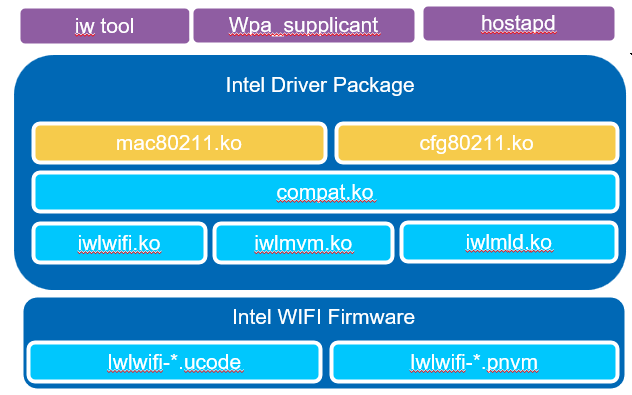
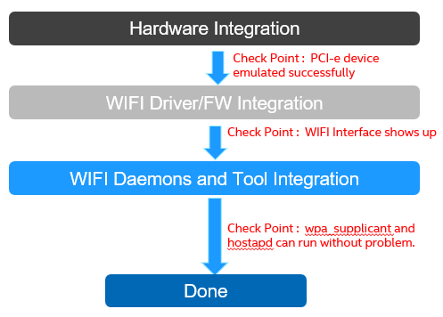

# Integration Guide

## Driver and Firmware Overview

Intel® Wi-Fi is natively supported in Linux. Intel upstreams the Wi-Fi driver kernel source tree to kernel.org., making it easy for customers to enable Intel® Wi-Fi. Intel also maintains an upstream backport driver to kernel.org. This approach benefits customers who require support for newer driver features on older kernel versions. This section provides guidance on how to integrate the Intel® Wi-Fi backport driver.

## Software Stack for the Backport Driver

The backport driver can be compatible with multiple kernel versions and tested against recent long-term kernel versions. In the following diagram, it shows the components that can be used in Linux.



### User-Space Tool and Daemon Components

These components include the wireless tool (iw tool), client daemon (wpa_supplicant) and AP daemon (hostapd). These components are not maintained by Intel and fully leverage components from the open-source community.

| Name | Purpose | Open-Source Community Website |
|------|---------|-------------------------------|
| wpa_supplicant | Daemon for controlling Wi-Fi in STA mode | [Documentation](https://wireless.docs.kernel.org/en/latest/en/users/documentation/wpa_supplicant.html) |
| hostapd | Daemon for controlling Wi-Fi in soft access point mode | [Documentation](https://wireless.docs.kernel.org/en/latest/en/users/documentation/hostapd.html) |
| iw tool | Tool for query and control Wi-Fi settings | [Documentation](https://wireless.docs.kernel.org/en/latest/en/users/documentation/iw.html) |

### Intel Driver Components

These components include the Wi-Fi frameworks — `mac80211.ko` and `cfg80211.ko`, backport driver abstraction layer — `compat.ko`, and Intel driver implementation — `iwlwifi.ko`, `iwlmld.ko` and `iwlmvm.ko`.

### Intel® Firmware Components

These components include the Wi-Fi firmware — `*.ucode` and regulatory support file `*.pnvm`.

## Intel® Wi-Fi Integration

This section describes the recommended workflow for enabling and integrating Intel® Wi-Fi on the target platform. A high-level flow diagram is shown below.



### Hardware Integration Phase

In this phase, the firmware of your platform will do the PCIe bus scan. The PCIe root complex (RC) will read both PCIe Vendor ID and PCIe Device ID from the Configuration Space Header and configuration space body. This will allow the PCIe link between the host and the Intel® Wi-Fi endpoint to be configured properly. This phase does not involve the Intel® Wi-Fi firmware or drivers, and is entirely managed by the platform PCIe host controller.

Use the following Linux command to verify that the module is detected and enumerated correctly:

```bash
lspci
```

The following is an example output:

```
6e:00.0 Network controller: Intel Corporation Device 2725
```


- `6e:00.0` — This is the BDF (Bus, Device, Function) node of your PCIe bus.
- `8086` — This is Intel's PCI Vendor ID.
- `2725` — This is the Device ID of Intel® Wi-Fi that you use. The example 0x2725 is the Device ID of AX210.

Refer to this table for the Intel discrete Wi-Fi Device ID:

| Wi-Fi Device | Device ID |
|-------------|-----------|
| AX210 | 0x2725 |
| BE200 | 0x272b |

### Software Integration Phase

This phase describes how to integrate Intel® Wi-Fi software components—including Linux kernel drivers and firmware—into a non-x86 platform.

The Intel® Wi-Fi backport driver is a self-contained, out-of-tree kernel module package. It includes its own compatible `cfg80211` and `mac80211` wireless subsystem layers, allowing it to work independently of the kernel's built-in wireless stack. This makes it suitable for a wide range of kernel versions and vendor-customized kernels. The driver can be built either natively on the target platform or cross-compiled from an x86 host, depending on platform capability and development environment.

## Build Methods

Choose the build method that best fits your platform:

| Method | Best For | Details |
|--------|----------|---------|
| [Native Build from Source](native-build.md) | Vendor-customized kernels | Build directly on the target platform |
| [Cross-Compilation from Source](cross-compile.md) | Embedded/resource-limited targets | Build on x86 host, deploy to target |

## Installing Prerequisites

Building the backport driver requires standard Linux kernel build tools: a C compiler, `make`, `flex`, `bison`, `bc`, and kernel header/crypto development libraries. Ensure these tools are installed on the build system — either the target platform (for native builds) or the x86 host (for cross-compilation).

For cross-compilation, a toolchain for the target architecture is also required.

Here is an example command to install prerequisites in Ubuntu:

```bash
sudo apt update
sudo apt install git build-essential bc flex bison libssl-dev libelf-dev
```

For other distributions or building environments, install the equivalent packages using your platform's package manager.

!!! note "Network Connectivity"
    If apt commands or git clone operations fail with connection errors (e.g., timeouts, "Could not resolve host", or "Failed to connect"), make sure the machine is able to connect to the APT Server. In some network environments the proxy setting may be required. Contact the network administrator regarding proxy setup.

## Wi-Fi Daemon and Tool Integration Phase

The components used in this phase are not provided or maintained by Intel. Refer to the following open-source community websites for details:

| Name | Purpose | Open-Source Community Website |
|------|---------|-------------------------------|
| wpa_supplicant | Daemon for controlling Wi-Fi in STA mode | [Documentation](https://wireless.docs.kernel.org/en/latest/en/users/documentation/wpa_supplicant.html) |
| hostapd | Daemon for controlling Wi-Fi in soft access point mode | [Documentation](https://wireless.docs.kernel.org/en/latest/en/users/documentation/hostapd.html) |
| iw tool | Tool for query and control Wi-Fi settings | [Documentation](https://wireless.docs.kernel.org/en/latest/en/users/documentation/iw.html) |
