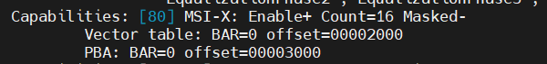

# Hardware Requirements

## PCIe Root Complex Considerations

Intel® Wi-Fi acts as a PCIe endpoint that is compliant with the PCIe standard. From a hardware logical design perspective, the platform should function as intended when PCIe specifications are fully met. However, the PCIe Root Complex (RC) of the target platform may have capability differences and constraints. The following table summarizes the key PCIe Root Complex (RC) capabilities required to support different Intel® Wi-Fi modules. Additional details are described in the following subsections.

Please consult your SoC/platform vendor for the information about PCIe root complex.

### PCIe Root Complex Capabilities Summary

| Capability | AX210 | BE200 |
|-----------|-------|-------|
| MSI-X Interrupt | Required | Required |
| PCIe de-emphasis control | Required | Required |
| PCIe relaxed ordering control | Required | Required |
| 5-Bit tags | Required | Required |
| Disable No Snoop | — | Required |

### MSI‑X Interrupt Support

Intel® Wi-Fi uses PCIe MSI-X (Message Signaled Interrupts Extended) for IRQ handling. The driver implementation does not support legacy line‑based interrupts. In PCIe Gen2, MSI‑X is an optional feature of the standard.

To verify this PCIe capability, check the platform using the following command:

```bash
sudo lspci -vvv
```

The output indicates MSI-X capability as `Enable+`.



### PCIe De‑emphasis Control

In PCIe Gen2, it is recommended to disable PCIe de-emphasis implemented on the Intel® Wi-Fi module. This configuration helps prevent PCIe device enumeration issues.

### PCIe Relaxed Ordering Control

Intel® Wi-Fi does not support PCIe relaxed ordering. Relaxed ordering must be disabled for PCIe Gen2 configurations.

### Support for PCIe 5‑Bit Tags

Intel® Wi-Fi supports only the 5-bit extended tag capability. Some PCIe Root Complexes (RCs) enable 8-bit or 10-bit tags by default. If this is the case, disable 8-bit and 10-bit tag support.

### No Snoop Support Limitation

Intel® BE200 Wi-Fi does not support No Snoop capability. Please make sure that No Snoop is disabled in PCIe Root Complexes (RCs).
